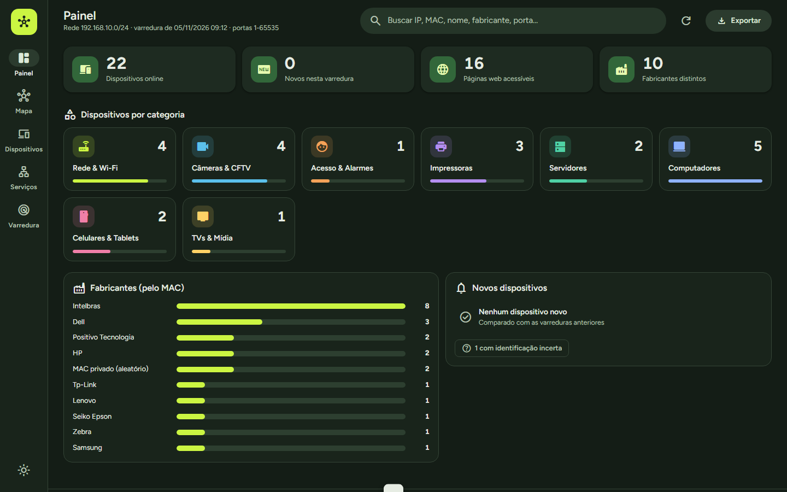
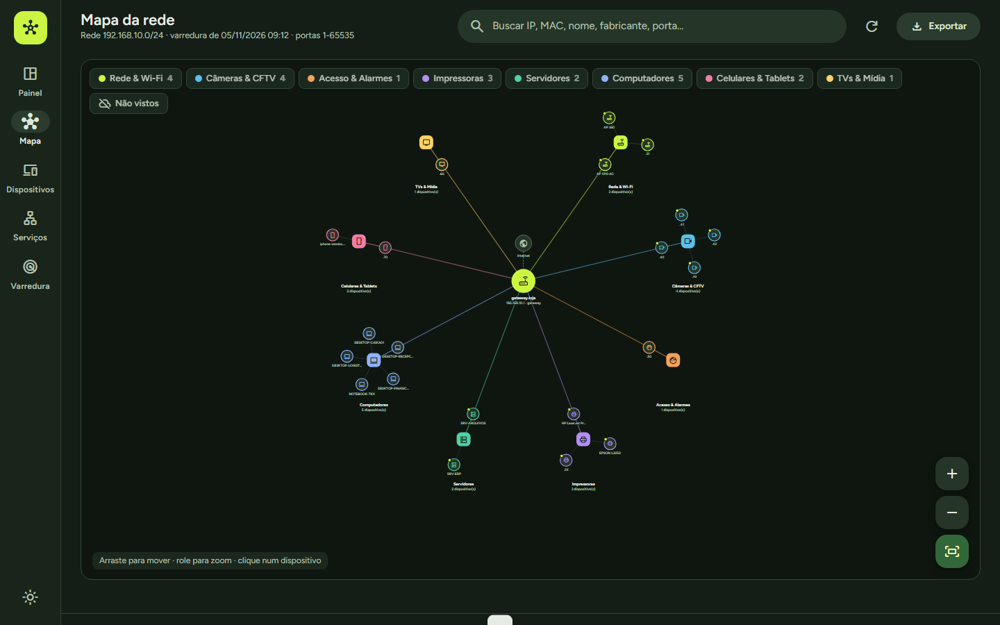
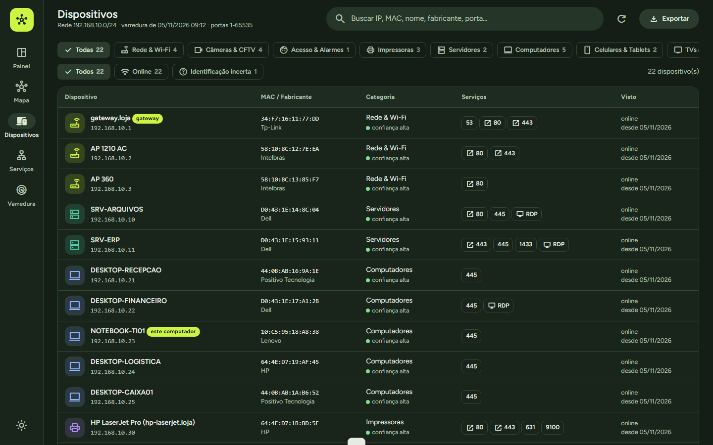
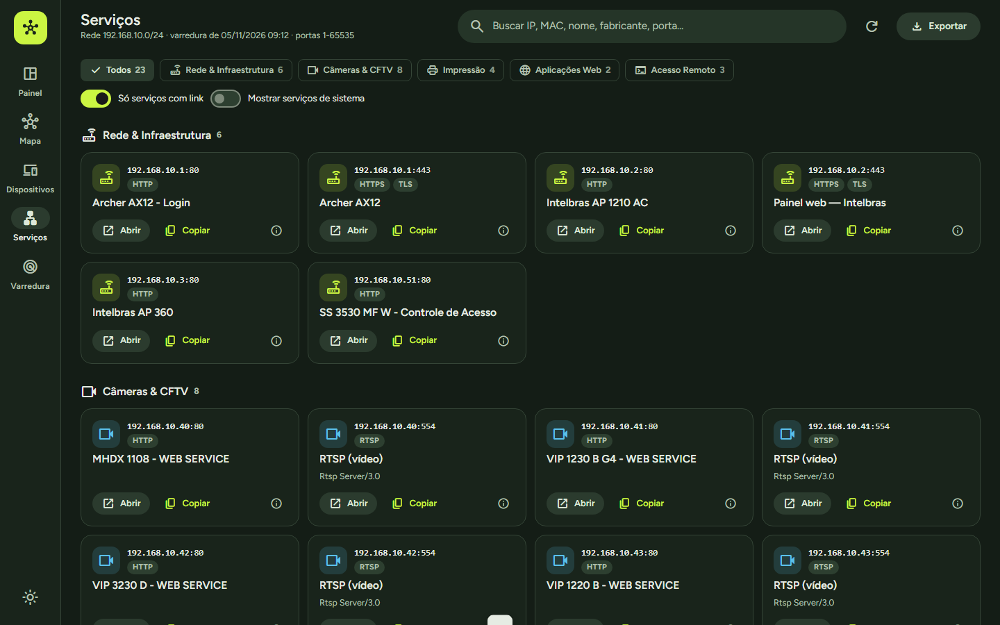

# Inventário de Rede — Make Distribuidora

Programa desktop que descobre, identifica (pelo MAC, portas e páginas web) e mapeia todos os dispositivos da rede.

## As telas



<table>
<tr>
<td width="50%"><br>
<b>Mapa da rede</b><br>
O gateway no centro e cada aparelho no seu grupo: rede e Wi-Fi, câmeras, impressoras, computadores, servidores, celulares e TVs.</td>
<td width="50%"><br>
<b>Dispositivos</b><br>
IP, MAC e fabricante de cada aparelho, a categoria deduzida com o grau de confiança e as portas abertas.</td>
</tr>
<tr>
<td><br>
<b>Serviços</b><br>
Cada página web, câmera (RTSP), impressora e acesso remoto encontrado, com o endereço pronto para abrir ou copiar.</td>
<td valign="top"><b>Como ele identifica cada aparelho</b>
<ul>
<li>Descobre quem está na rede por ping e pela tabela ARP, e consulta os APs Intelbras pelo protocolo de descoberta deles (modelo e firmware).</li>
<li>Varre as portas TCP e lê o que cada serviço responde: título da página, servidor, RTSP, impressão RAW.</li>
<li>Descobre o fabricante pelo prefixo do MAC (base pública do IEEE) e marca MAC privado/aleatório.</li>
<li>Classifica cada aparelho com as evidências e o grau de confiança.</li>
<li>Guarda o inventário: nomes e categorias que você define, primeira e última vez visto, aviso de aparelho novo.</li>
</ul></td>
</tr>
</table>

<sub>Capturas de um ambiente de demonstração: a rede, os nomes e os endereços são fictícios. Os fabricantes vêm da base pública do IEEE.</sub>

## Instalar em outra máquina / empresa

Baixe na página de [Releases](../../releases/latest) e execute — cada instalador é um único arquivo com tudo dentro:

| Versão | Tamanho | Quando usar |
|---|---|---|
| **`Instalador-InventarioRede-1.1.0-offline.exe`** | ≈218 MB | Instala **sem internet** — traz o Microsoft WebView2 completo |
| **`Instalador-InventarioRede-1.1.0-online.exe`** | ≈14 MB | Download leve — se a máquina não tiver WebView2, baixa da Microsoft |

Na dúvida, use a **offline**. No Windows 11 e na maioria dos Windows 10 o WebView2 já existe, e as duas funcionam igual.
Ele já inclui Python, bibliotecas, interface e a base de fabricantes. Requisitos: Windows 10/11 64 bits.
O instalador detecta o WebView2 pelo registro e pelos arquivos no disco, e só instala se realmente faltar.

- Instala em `C:\Program Files\Inventario de Rede` (ou só para o usuário, se escolher no início).
- Dados (inventário, histórico, varreduras): `%LOCALAPPDATA%\InventarioRede\dados` — faça cópia dessa pasta para guardar.
- Instalação silenciosa (TI): `Instalador-InventarioRede-1.1.0-offline.exe /VERYSILENT /SUPPRESSMSGBOXES`
- Feche o Inventário de Rede antes de reinstalar/atualizar (o instalador avisa se ele estiver aberto).

## Estrutura do projeto

| Arquivo | O que é |
|---|---|
| `app.py` | Programa principal: servidor local (127.0.0.1) + janela nativa (pywebview/WebView2) |
| `app.html` | Interface (Material Design, cores Make): painel, mapa, dispositivos, serviços, varredura |
| `varredura.py` | Scanner: descoberta (ping/ARP e consulta de APs Intelbras), portas TCP, identificação de serviços, nomes |
| `identificar.py` | Fabricante pelo MAC, categorias por evidências, inventário persistente, exportação |
| `dados\` | Dados locais de desenvolvimento (não versionados) e `oui.csv` (baixado pelo build) |
| `instalador\` | Build: `build.ps1`, `InventarioRede.spec` (PyInstaller), `InventarioRede.iss` (Inno Setup), imagens |

## Rodar sem instalar (desenvolvimento)

```
python app.py               # janela própria
python app.py --navegador   # no navegador
```

## Gerar o instalador de novo (após mudar o código)

Requisitos só na máquina que gera: Python 3.12+, `pip install pyinstaller pywebview pillow`, Inno Setup 6.
O `build.ps1` baixa sozinho a base de fabricantes (IEEE) e os dois instaladores do WebView2 (Microsoft), e gera as duas versões (online e offline).

```
powershell -ExecutionPolicy Bypass -File instalador\build.ps1
```

Para mudar a versão, altere `VERSAO` em `app.py`, `AppVersion` em `instalador\InventarioRede.iss` e `instalador\versao.txt`.

> O instalador novo sai na raiz desta pasta. Gere a partir de uma pasta com caminho curto (ex.: Área de Trabalho). Caminhos com mais de
> 260 caracteres impedem o executável de achar as DLLs do WebView2 quando roda direto de `instalador\dist`.
