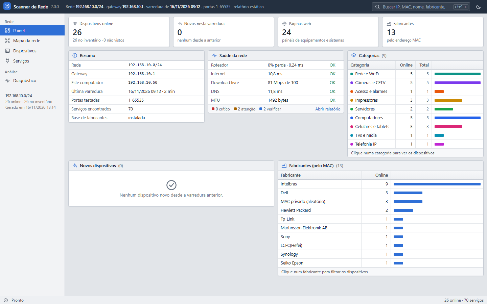
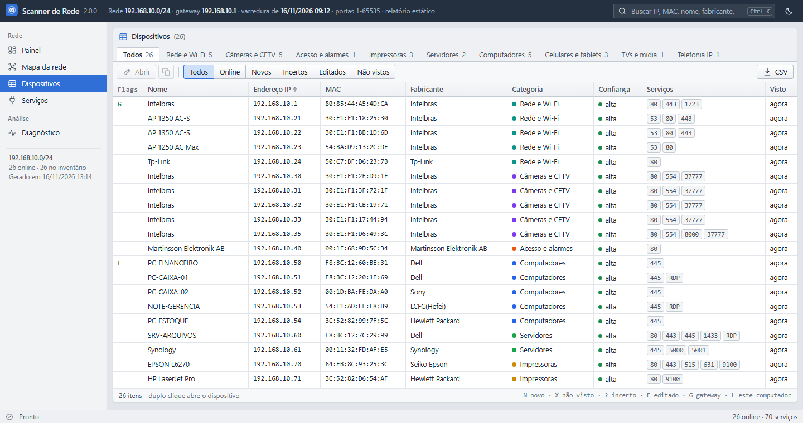
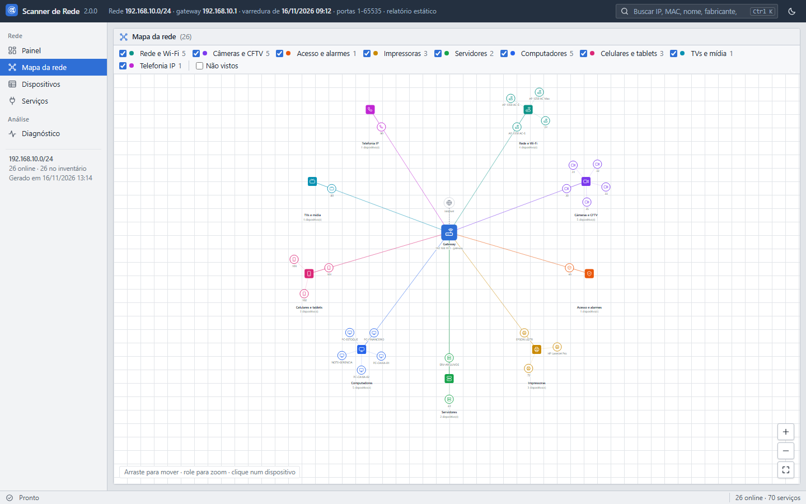
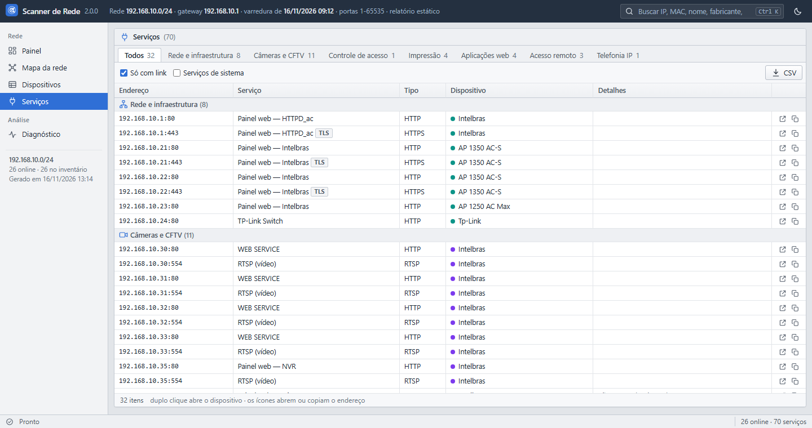
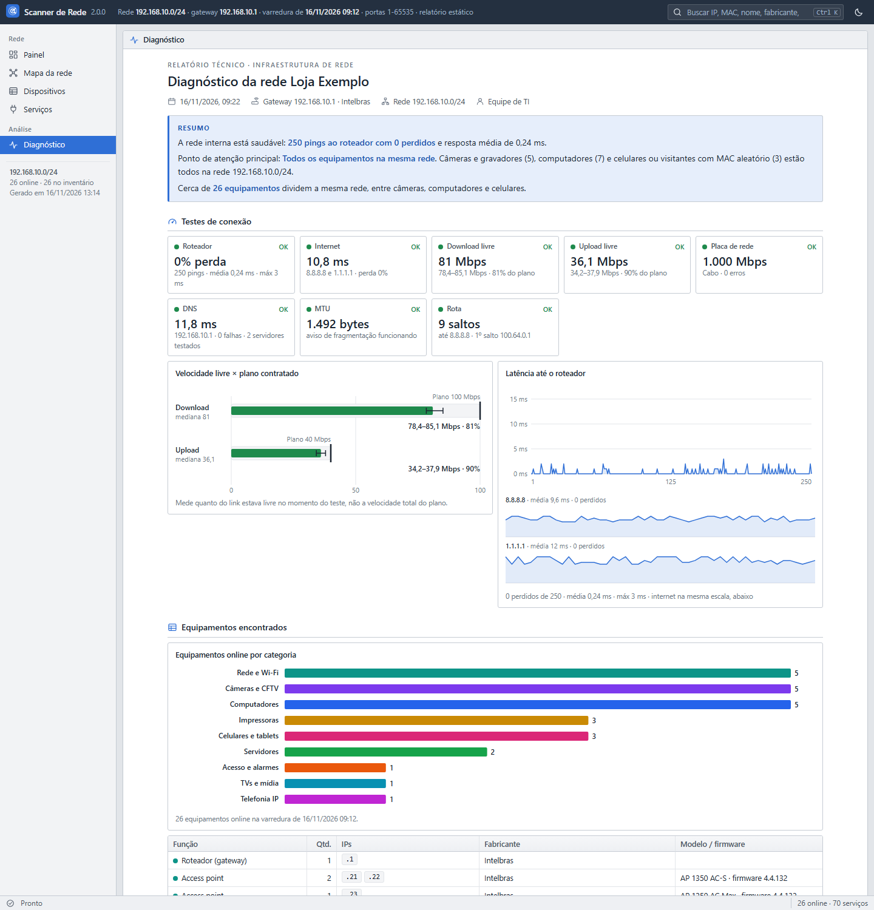

# Scanner de Rede

Ferramenta para Windows que descobre, identifica e mapeia todos os dispositivos da rede local e faz o diagnóstico da conexão, com relatório pronto para entregar.

## As telas



<table>
<tr>
<td width="50%"><br>
<b>Dispositivos</b><br>
Abas por categoria, filtros, colunas ordenáveis e marcas (novo, não visto, incerto, editado). Duplo clique abre a janela do dispositivo.</td>
<td width="50%"><br>
<b>Mapa da rede</b><br>
O gateway no centro e cada aparelho no seu grupo: rede e Wi-Fi, câmeras, impressoras, computadores, servidores, celulares e TVs.</td>
</tr>
<tr>
<td><br>
<b>Serviços</b><br>
Cada página web, câmera (RTSP), impressora e acesso remoto encontrado, com o endereço pronto para abrir ou copiar.</td>
<td><br>
<b>Diagnóstico</b><br>
Testa roteador, internet, DNS, MTU, rota e velocidade e monta um relatório com pontos encontrados e plano de ação, que pode ser exportado e impresso.</td>
</tr>
</table>

<sub>Capturas de uma rede fictícia, geradas por <code>docs\gerar_telas.py</code>. Os fabricantes vêm da base pública do IEEE.</sub>

## O que ele faz

- **Descoberta:** ping, portas comuns, tabela ARP confirmada na hora e a consulta de descoberta dos APs e rádios Intelbras (modelo e firmware).
- **Identificação:** fabricante pelo MAC (base do IEEE), serviço de cada porta (título da página, banner, TLS, RTSP) e categoria por evidências, com grau de confiança.
- **Inventário:** nomes, categorias e notas que você define, primeira e última vez visto e aviso de dispositivo novo.
- **Diagnóstico:** perda e latência até o roteador, internet, DNS, MTU, rota e velocidade livre comparada ao plano contratado; achados com severidade e plano de ação.
- **Exportação:** um HTML único que abre sem o programa e sem internet, e listas em CSV.

## Instalar

Baixe na página de [Releases](../../releases/latest) e execute. Cada instalador é um único arquivo com tudo dentro:

| Versão | Tamanho | Quando usar |
|---|---|---|
| **`Instalador-ScannerDeRede-2.0.1-offline.exe`** | ≈218 MB | Instala **sem internet**: traz o Microsoft WebView2 completo |
| **`Instalador-ScannerDeRede-2.0.1-online.exe`** | ≈14 MB | Download leve: se a máquina não tiver WebView2, baixa da Microsoft |

Na dúvida, use a **offline**. No Windows 11 e na maioria dos Windows 10 o WebView2 já existe, e as duas funcionam igual.
Requisitos: Windows 10 ou 11, 64 bits.

- Instala em `C:\Program Files\Scanner de Rede` (ou só para o usuário, se escolher no início).
- Dados (inventário, histórico, varreduras, diagnóstico): `%LOCALAPPDATA%\ScannerDeRede\dados`. Faça cópia dessa pasta para guardar.
- Se a versão anterior (**Inventário de Rede 1.x**) estiver instalada, o instalador a remove e o programa traz o inventário dela na primeira vez que abrir.
- Instalação silenciosa (TI): `Instalador-ScannerDeRede-2.0.1-offline.exe /VERYSILENT /SUPPRESSMSGBOXES`

## Uso responsável

Use apenas em redes que você administra ou tem autorização para inventariar. Varreduras de portas podem ser registradas por firewalls. O programa roda só neste computador (127.0.0.1) e não envia dados da rede para fora; as conexões externas são a atualização da base de fabricantes (IEEE) e, no diagnóstico, pings e DNS para 8.8.8.8 e 1.1.1.1 e o teste de velocidade opcional (speed.cloudflare.com).

## Estrutura do projeto

| Arquivo | O que é |
|---|---|
| `app.py` | Programa principal: servidor local (127.0.0.1) + janela nativa (pywebview/WebView2) |
| `app.html` | Interface: painel, mapa, dispositivos, serviços, diagnóstico e varredura (ícones e estilos embutidos, sem dependências externas) |
| `varredura.py` | Scanner: descoberta (ping, ARP, APs Intelbras), portas TCP, identificação de serviços, nomes |
| `identificar.py` | Fabricante pelo MAC, categorias por evidências, inventário persistente, exportação |
| `diagnostico.py` | Diagnóstico: testes de conexão (ICMP, DNS, MTU, rota, velocidade) e motor de achados do relatório |
| `docs\gerar_telas.py` | Gera as capturas do README com uma rede fictícia |
| `dados\` | Dados locais de desenvolvimento (não versionados) e `oui.csv` (baixado pelo build) |
| `instalador\` | Build: `build.ps1`, `ScannerDeRede.spec` (PyInstaller), `ScannerDeRede.iss` (Inno Setup), ícone e imagens |

## Rodar sem instalar (desenvolvimento)

```
python app.py               # janela própria
python app.py --navegador   # no navegador
```

## Gerar o instalador de novo

Requisitos só na máquina que gera: Python 3.12+, `pip install pyinstaller pywebview pillow`, Inno Setup 6.
O `build.ps1` baixa sozinho a base de fabricantes (IEEE) e os dois instaladores do WebView2 (Microsoft), e gera as duas versões (online e offline).

```
powershell -ExecutionPolicy Bypass -File instalador\build.ps1
```

Para mudar a versão, altere `VERSAO` em `app.py`, `AppVersion` em `instalador\ScannerDeRede.iss` e `instalador\versao.txt`.

> O instalador novo sai na raiz desta pasta. Gere a partir de uma pasta com caminho curto (ex.: Área de Trabalho). Caminhos com mais de
> 260 caracteres impedem o executável de achar as DLLs do WebView2 quando roda direto de `instalador\dist`.
